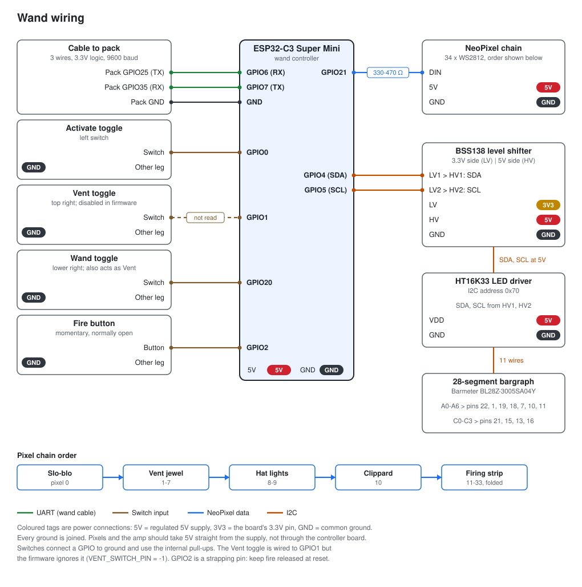
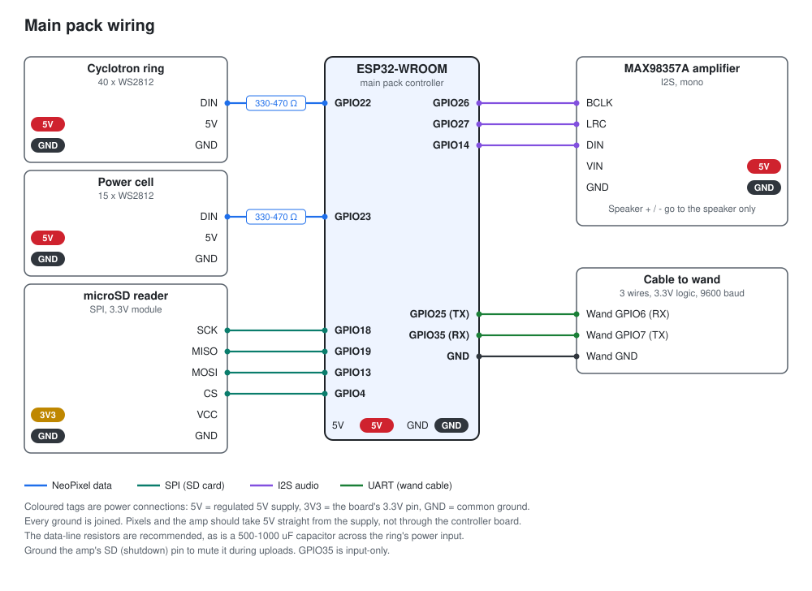

# Hardware and wiring

All pin assignments live in [include/Config.h](../include/Config.h) (pack) and
[include/WandConfig.h](../include/WandConfig.h) (wand). Compile-time checks
reject clashing pins.

## General rules

- Disconnect power before rewiring.
- Never connect 5V to a GPIO. All switches connect between a GPIO and GND and
  use the internal pull-ups, so a closed switch reads LOW.
- Power NeoPixels from a regulated 5V supply, with its ground joined to the
  board's ground. Do not power them from a 3.3V pin.
- When a board is powered over USB, do not also feed an external supply into
  its power pins.
- Put a 330-470 ohm resistor in series with each NeoPixel data line, near DIN.
  A 5V-powered 74AHCT125 level shifter makes the 3.3V data signal reliable.
- Software brightness is not a substitute for an adequate supply, wiring and
  circuit protection.

The diagrams on this page are generated by
[images/generate_wiring.py](images/generate_wiring.py). They show connections,
not a full electrical schematic.

## Wand (ESP32-C3 Super Mini)

| Connection | GPIO | Notes |
| --- | --- | --- |
| Activate switch | 0 | Left toggle. Wand and pack power |
| Vent switch | 1 | Top right toggle. **Currently disabled**, see below |
| Wand switch | 20 | Lower right toggle. Arms the wand (Clippard light) |
| Fire button | 2 | Momentary, normally open |
| NeoPixel data | 21 | One chain of 34 pixels |
| Bargraph SDA / SCL | 4 / 5 | Through a BSS138 level shifter to the HT16K33 |
| Pack UART RX / TX | 6 / 7 | To pack GPIO25 / GPIO35 |

The Vent switch on this build stopped responding after the shell was fitted, so
`VENT_SWITCH_PIN = -1` and `VENT_FOLLOWS_WAND_SWITCH = true`: the lower right
switch acts as both Vent and wand switch. Set the pin back to `1` and the flag
to `false` to use a separate Vent switch.

GPIO2 is a strapping pin, so keep the fire button released during reset and
upload. GPIO18 and 19 are reserved for USB.

### Wand pixel chain

| Section | Pixels | Count |
| --- | --- | --- |
| Slo-blo | 0 | 1 |
| Vent jewel | 1-7 | 7 |
| Hat lights | 8-9 | 2 |
| Clippard | 10 | 1 |
| Firing strip | 11-33 | 23 |

Pixels are WS2812-compatible, GRB order, 800 kHz, at full brightness. The
firing strip is folded, so its physical tip is the 12th strip pixel (chain
index 22, `FIRING_TIP_PIXEL`). All 34 pixels at full white can draw about 2A;
a regulated 5V 3A supply leaves headroom.

### Bargraph

The display is a 28-segment Barmeter BL28Z-3005SA04Y driven by an HT16K33 at
I2C address `0x70`, 100 kHz. It is wired as in
[GPStar's bargraph guide](https://github.com/GPStarTechnologies/GPStar-Core-Source/blob/main/docs/BARGRAPH.md):
driver A0-A6 to display pins 22, 1, 19, 18, 7, 10, 11, and C0-C3 to pins 21, 15,
13, 16.

The C3 side of the level shifter runs at 3.3V. The HT16K33 VDD and the
shifter's HV reference both need the regulated 5V supply; the driver answers on
I2C without it but will not light the display.

## Main pack (ESP32-WROOM)

| Connection | GPIO | Notes |
| --- | --- | --- |
| Cyclotron ring data | 22 | 40 pixels |
| Power cell data | 23 | 15 pixels, its own data line |
| Wand UART TX / RX | 25 / 35 | To wand GPIO6 / GPIO7. GPIO35 is input-only |
| Amp BCLK / LRCLK / DIN | 26 / 27 / 14 | MAX98357A |
| SD SCK / MISO / MOSI / CS | 18 / 19 / 13 / 4 | 3.3V SPI microSD reader |

GPIO numbers are the pin labels (22 or IO22), not physical pin positions.

### Lights

The ring and power cell are 5V WS2812 RGB pixels, GRB order. The ring's four
lens windows are six pixels wide, centred on pixels 0, 10, 20 and 30. Adjust
`AFTERLIFE_WINDOW_OFFSET` and `AFTERLIFE_WINDOW_PIXELS` to match how your ring
is mounted.

A 500-1000 uF capacitor (10V or more) across the ring's power input is
recommended. The normal effects light only a few dim pixels, but the ring and
power cell together can draw about 3.3A at full white.

### Audio

| MAX98357A pin | Connects to |
| --- | --- |
| VIN | Regulated 5V |
| GND | Common ground |
| BCLK / LRC / DIN | GPIO26 / GPIO27 / GPIO14 |
| SD (shutdown) | Ground it to mute the amp during uploads and resets |
| Speaker + / - | The speaker only. Neither connects to ground |

The amp's SD pin is shutdown and channel select, not the SD card. Firmware
cannot keep the amp quiet during reset or while the ESP32 is unpowered, so mute
or unpower the amp before uploading.

The microSD reader is a 3.3V part: power it from 3V3, not 5V. It uses GPIO13
for MOSI because the default GPIO23 drives the power cell.

### Optional pack switches

With `WAND_LINK_ENABLED = false` the pack can run standalone with its own
controls. All are unassigned (`-1`) by default; suggested pins:

| Control | GPIO | Setting |
| --- | --- | --- |
| Pack power toggle | 32 | `PACK_SWITCH_PIN` |
| Fire button | 17 | `FIRE_BUTTON_PIN` |
| Vent button | 33 | `VENT_BUTTON_PIN` |

Set `PACK_SWITCH_MOMENTARY = true` if the power control is a push button.

## Wand-to-pack cable

| Wire | Wand (C3) | Pack (ESP32) |
| --- | --- | --- |
| Green | GPIO6 RX | GPIO25 TX |
| Blue | GPIO7 TX | GPIO35 RX |
| Ground | GND | GND |

Both ends use 3.3V logic; do not route these through the bargraph's 5V level
shifter. Share ground, but do not join the two boards' USB 5V supplies. The
protocol is described in [uart-link.md](uart-link.md).

## Power

Wi-Fi adds transmit bursts of around 300 mA, and loud audio pulls the supply
down. If the ESP32 shares a battery feed with the amp and pixels, expect
brownout resets while firing. Give the ESP32 its own 5V supply or regulator and
run the amp and pixels on separate thick wires from the battery, with all
grounds joined.
